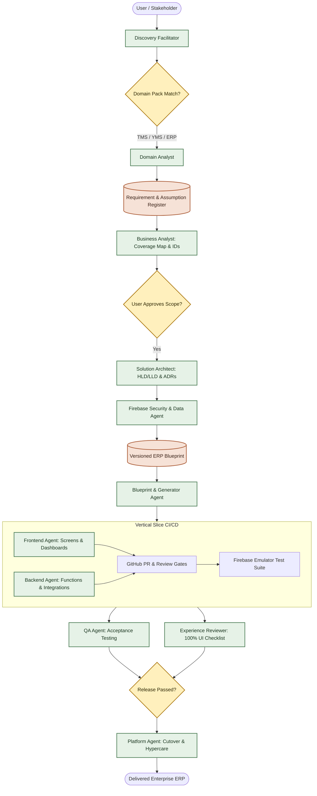
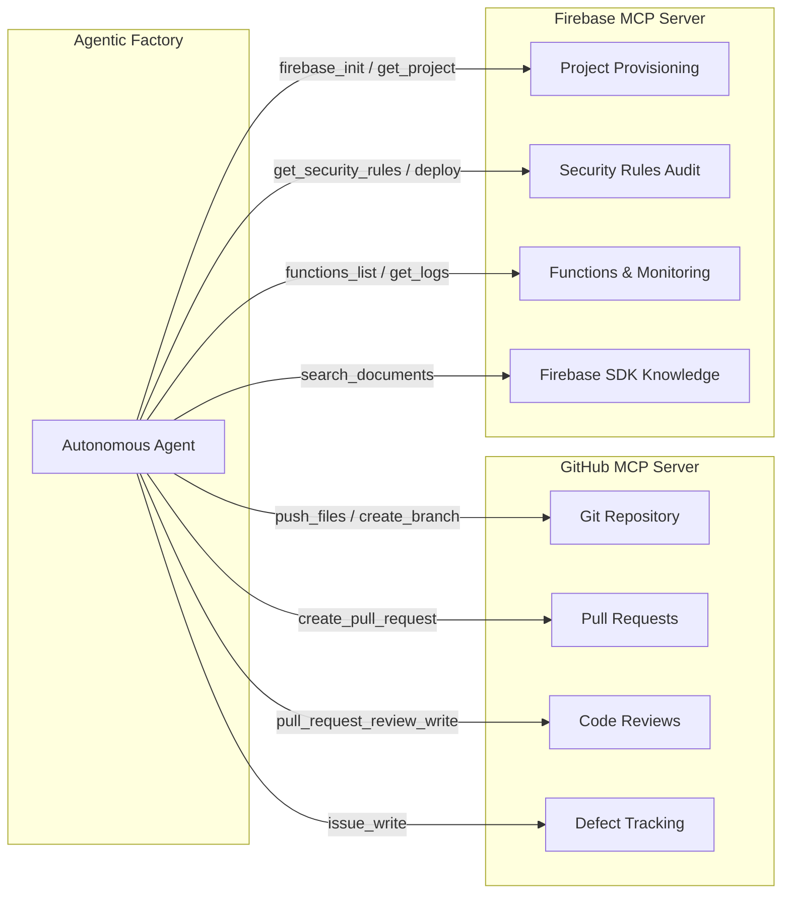

# Agentic ERP Software Builder 🚀
### Autonomous Multi-Agent Software Factory for Enterprise ERP & Real-Time Dashboard Development

[](https://github.com/andrew/agentic-erp-software-builder)
[](https://opensource.org/licenses/MIT)
[](https://firebase.google.com/)
[-green?style=for-the-badge)](https://www.asd-ste100.org/)
[](https://modelcontextprotocol.io/)

**Agentic ERP Software Builder** is an autonomous multi-agent **software factory** engineered for rapid **agentic development**, end-to-end **ERP development**, and interactive **dashboard development**. Built on **Firebase** (Cloud Firestore, Data Connect PostgreSQL, and Cloud Functions) and frontend frameworks (React / Angular), it automates the full lifecycle: requirement discovery for uncertain users, system architecture, vertical slice code generation, test automation, and release governance.

All technical outputs follow the **ASD-STE100 Simplified Technical English** controlled language standard (as advocated by Andrej Karpathy) and a mathematical **Goal-and-Reward evaluation framework** ensuring zero hallucinations, zero skipped tests, and 100% verifiable deliveries.

---

## 📑 Table of Contents
- [Why Agentic ERP Software Builder?](#-why-agentic-erp-software-builder)
- [Software Factory Architecture](#-software-factory-architecture)
- [Core Agent Roster & Quantifiable Goals](#-core-agent-roster--quantifiable-goals)
- [Goal and Reward Scoring Framework](#-goal-and-reward-scoring-framework)
- [Discovery for Uncertain Stakeholders](#-discovery-for-uncertain-stakeholders)
- [Enterprise ERP & Dashboard Capabilities](#-enterprise-erp--dashboard-capabilities)
- [Firebase & GitHub MCP Tool Integrations](#-firebase--github-mcp-tool-integrations)
- [ASD-STE100 Controlled Language Standard](#-asd-ste100-controlled-language-standard)
- [Quick Start Guide](#-quick-start-guide)
- [Repository Structure & Templates](#-repository-structure--templates)
- [Roadmap & Contribution](#-roadmap--contribution)

---

## ⚡ Why Agentic ERP Software Builder?

Traditional custom ERP and dashboard development suffers from scope ambiguity, architectural drift, massive human engineering costs, and unmaintained documentation. 

**Agentic ERP Software Builder** turns development into a repeatable, automated assembly line:

| Challenge in Traditional ERP & Dashboard Dev | Solution in Agentic Software Factory |
| :------------------------------------------- | :----------------------------------- |
| **Ambiguous Requirements** | **Discovery Facilitator** guides uncertain users via scenario walk-throughs, sizing presets, and safe defaults. |
| **Big-Bang Integration Hell** | **Vertical Slice Delivery**: code, review, and test one workflow/screen at a time with CI previews. |
| **Unchecked Hallucinations** | **Goal-and-Reward Gates ($0.0 - 1.0$)**: agents only earn completion when meeting quantifiable quotas. |
| **Context Bloat & Fluff** | **ASD-STE100 Controlled Language**: concise, active-voice, audited documentation ($\le 20$ words per step). |
| **Manual Cloud Provisioning** | **Native MCP Automation**: direct Firebase and GitHub resource orchestration via Model Context Protocol. |

---

## 🏗️ Software Factory Architecture

The software factory operates across two interconnected pipelines: **Requirements & Scope Discovery** and **Slice Delivery & Release**.



---

## 🤖 Core Agent Roster & Quantifiable Goals

Every agent in the software factory has explicit responsibilities, quantifiable output quotas, and gate pass criteria:

| Agent Role | Domain Specialization | Quantifiable Goal / Target Quota | Reward Pass Gate |
| :--------- | :-------------------- | :------------------------------- | :--------------- |
| **ERP Product Orchestrator** | Factory governance & cycle bounds | 100% structured handoff packages; $\le 24\text{h}$ slice cycle time; 0 loops $>3$. | Score $\ge 0.95$ |
| **Discovery Facilitator** | Requirement extraction for unsure users | 100% questions provide defaults; 0 blocking questions entering build. | Score $\ge 0.90$ |
| **Domain Analyst** | Domain packs (TMS, YMS, ERP, Finance) | 100% domain terminology mapped to glossary; 100% entity transitions defined. | Score $\ge 0.90$ |
| **Business Analyst** | Requirements & acceptance criteria | 100% coverage across 10 areas; $\ge 2$ concrete examples per criterion. | Score $= 1.0$ |
| **Solution Architect** | Firebase topology & cost modeling | 100% choices documented in ADRs; Firebase monthly cost within $\pm 15\%$ budget. | Score $\ge 0.95$ |
| **Identity & Security Agent**| Firebase Auth, Rules, App Check | 100% collection paths secured; 100% branch test coverage in Firebase Emulator. | Score $= 1.0$ |
| **Data Agent** | Firestore / PostgreSQL Data Connect | 100% queries backed by indexes; 100% migration field reconciliation. | Score $\ge 0.95$ |
| **Blueprint & Generator** | Component library & code scaffolding | $\ge 60\%$ boilerplate generated; 0 custom code overwrites on regeneration. | Score $\ge 0.90$ |
| **Frontend Agent** | React/Angular dashboards & workflows | 100% screen inventory compliance; Lighthouse Performance $\ge 85$, A11y $\ge 90$. | Score $\ge 0.90$ |
| **Backend & Integration** | Cloud Functions & external APIs | 100% idempotent financial writes; Cold-start $\le 1500\text{ms}$; execution $\le 500\text{ms}$. | Score $\ge 0.95$ |
| **Experience Reviewer** | UX & UI verification checklist | **Itemize and verify 100% of discrete UI functionalities & 5 UI states.** | Score $= 1.0$ |
| **QA Agent** | Test automation & traceability | **$\ge 1$ executable test case per acceptance scenario**; 100% test pass in staging. | Score $= 1.0$ |
| **Code Reviewer** | Security, performance, maintainability | 100% PRs audited; 0 unresolved Blocker/High findings merged to main. | Score $= 1.0$ |
| **Project Documentation** | ASD-STE100 audits & traceability | **$\ge 80\%$ ASD-STE100 compliance**; 100% requirement-to-test traceability. | Score $\ge 0.85$ |
| **Platform & Release Agent** | CI/CD, environments, cutover | 100% isolated Firebase environments; Rollback automated in $\le 5\text{min}$. | Score $\ge 0.95$ |

---

## 🎯 Goal and Reward Scoring Framework

To eliminate lazy agent handoffs, skipped scenarios, and incomplete code, the software factory uses a mathematical reward function:

$$S = \max\left(0.0, 1.0 - \sum P_i\right) \times \mathbb{I}_{\text{Safety}}$$

### Defect Penalty Matrix ($P_i$)
- **Missing Acceptance Scenario:** `-0.15` per omission.
- **Unitemized UI Element or Missing State (Loading/Empty/Error):** `-0.20`.
- **Unindexed Firestore Query / Missing Index:** `-0.25`.
- **Unaddressed High-Severity PR Review Issue:** `-0.30`.
- **ASD-STE100 Sentence Violation (>25 words):** `-0.05` per violation.
- **API Latency Budget Exceeded (>500ms):** `-0.20`.

### Safety Indicator ($\mathbb{I}_{\text{Safety}} = 0$)
Immediate score reset to **$0.0$** and gate rejection occurs on:
1. Hardcoded API keys, private keys, or credentials.
2. Permissive wildcard security rules (`allow read, write: if true;`).
3. Broken build or unhandled promise rejection in CI.

---

## 🔍 Discovery for Uncertain Stakeholders

Stakeholders rarely know their exact database schemas or edge cases. The **Discovery Facilitator** uses proven interaction modes:

1. **Pain-First Discovery:** Focuses on current manual bottlenecks and spreadsheet pain points rather than technical requests.
2. **Interactive Sizing Presets:** Small, Medium, or Large operational profiles with pre-configured transaction defaults.
3. **Keep / Change / Remove Workflows:** Users review visual domain packs and mark existing reference steps.
4. **Concrete "What-If" Scenarios:** Resolves business rules using realistic edge cases (e.g., *"Customer orders 10 units, but you have 7 in stock. What happens?"*).
5. **Assumption Register:** Every ambiguous answer is classified as **Confirmed**, **Assumed** (with default rationale), or **Deferred** (with a decide-by date). Nothing blocks progress.

---

## 📊 Enterprise ERP & Dashboard Capabilities

The factory is optimized for data-dense, mission-critical operational systems:

- **Deterministic Agent Orchestration:** State-graph execution engine with Zod schema validation, 3-tier memory tiering, and loop bounding.
- **Executive KPI Dashboards:** Real-time analytics with sub-second aggregate updates via Firestore listeners and Cloud Functions.
- **Financial Controls & Invariant Ledgers:** Double-entry bookkeeping ($\sum \text{Debits} = \sum \text{Credits}$), sequential gapless numbering, and append-only audit trails via Firebase Data Connect (PostgreSQL).
- **Distributed Sagas & Outbox Pattern:** Cross-aggregate workflows with automated compensating transactions to eliminate dual-write failures.
- **Durable Queueing & Background Jobs:** Google Cloud Tasks and Pub/Sub integration for rate-limiting, batch billing, and retries with DLQs.
- **Full-Text & Faceted Search:** High-speed multi-field search and filtering powered by Typesense / Algolia via Firestore CDC triggers.
- **Transportation Management (TMS):** Multi-stop route planning, dispatch tracking, driver verification, and carrier freight audit.
- **Yard Management (YMS):** Real-time gate check-in/out, trailer inventory tracking, dock appointments, and dwell time alerts.
- **Inventory & Warehouse Systems:** Multi-location stock tracking, reorder thresholds, batch/lot management, and barcode scanning.
- **Mandatory 5-State UI Pattern:** Every operational screen implements:
  `Default` • `Loading Skeleton` • `Empty State` • `Error Banner` • `Unauthorized Redirection`.

---

## 🔌 Firebase & GitHub MCP Tool Integrations

Agents interact directly with cloud infrastructure and version control using standard **Model Context Protocol (MCP)** servers:



---

## 📖 ASD-STE100 Controlled Language Standard

All technical artifacts (specifications, ADRs, test plans, and handoffs) are strictly audited for **ASD-STE100 Simplified Technical English** (~80% target compliance) to minimize LLM fluff:
- **Sentence Length:** $\le 20$ words for procedural steps; $\le 25$ words for descriptive context.
- **Active Voice:** Direct imperative action verbs (`Deploy`, `Verify`, `Assert`).
- **No Ambiguous Synonyms:** Strict one-meaning-per-word policy.
- **Visual-First Hierarchy:** Multi-variable data must be rendered in **Mermaid diagrams** or **Markdown tables** before writing prose.

---

## 🚀 Quick Start Guide

### 1. Clone Repository & Install Custom Agent
```bash
git clone https://github.com/andrew/agentic-erp-software-builder.git
cd agentic-erp-software-builder
```

### 2. Configure MCP Server Connections
Ensure your local or remote agent harness exposes `github-mcp-server` and `firebase-mcp-server`:
```json
{
  "mcpServers": {
    "github": {
      "command": "npx",
      "args": ["-y", "@modelcontextprotocol/server-github"]
    },
    "firebase": {
      "command": "npx",
      "args": ["-y", "firebase-mcp-server"]
    }
  }
}
```

### 3. Run Local Emulator & CI Verification
```bash
# Start Firebase Local Emulator Suite
firebase emulators:start --only firestore,auth,functions

# Run Slice Verification Suite
npm run test:ci
```

---

## 📂 Repository Structure & Templates

```text
agentic-erp-software-builder/
├── .github/
│   ├── agents/
│   │   └── agentic-erp-builder.agent.yml   # Custom GitHub Agent definition
│   └── workflows/
│       └── agentic_ci_gate.yml             # Automated CI slice & STE100 audit gate
├── templates/
│   ├── requirement_template.md             # ASD-STE100 Requirement Specification
│   ├── adr_template.md                     # Architecture Decision Record template
│   ├── test_case_template.md               # QA Executable Test Case template
│   ├── ui_functionality_checklist_template.md # 100% UI Functionality & 5-State list
│   └── handoff_package_template.md         # Context-contained agent handoff
├── references/
│   ├── agent_orchestration_runtime.md      # State-graph engine, Zod schemas, 3-tier memory
│   ├── asd_ste100_guide.md                 # Controlled language rules & audit scoring
│   ├── firebase_erp_patterns.md            # Storage, financial ledgers, sagas, queues, search
│   └── goal_reward_scoring.md              # Mathematical scoring & penalty formulation
├── Agentic ERP Software Builder.md         # Complete Software Factory Master Plan
├── Resource Planning.md                    # Lean staffing & capacity allocation plan
└── README.md                               # SEO-optimized documentation entry point
```

---

## 🤝 Roadmap & Contribution

- [x] Master Software Factory Plan & Agent Roster.
- [x] ASD-STE100 Controlled Language Standard & Audit Criteria.
- [x] Goal and Reward Evaluation Framework ($0.0 - 1.0$).
- [x] Templates for Requirements, ADRs, QA Test Cases, and UI Checklists.
- [x] Firebase and GitHub MCP Tool Integration Architecture.
- [ ] Pre-built Domain Packs: TMS (Transport), YMS (Yard), Inventory, and Procurement.
- [ ] Automatic Blueprint Compiler for React & Angular Dashboard Scaffolding.

Contributions, issue reports, and domain pack submissions are welcome! Please open a GitHub Pull Request following our [handoff package template](templates/handoff_package_template.md).

---

## 📄 License

This project is licensed under the [MIT License](LICENSE).
