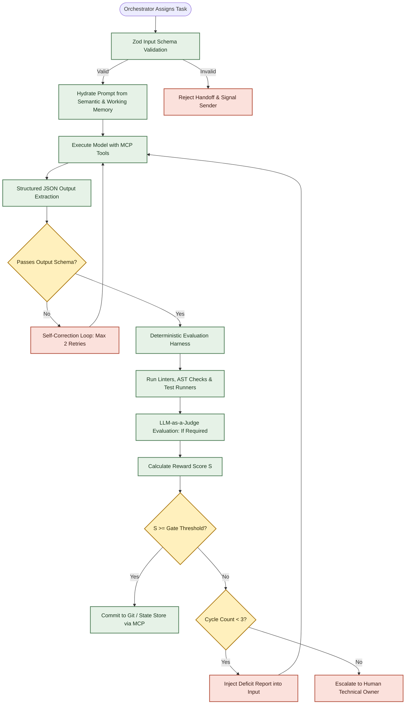

# Agent Orchestration & Runtime Specification

<!-- Technical blueprint for the agent execution engine, schema validation, memory tiering, and runtime evaluation harness. -->

## 1. Orchestration Engine Architecture

The software factory operates on a deterministic state machine runtime (e.g., Google Antigravity SDK / LangGraph). Every agent step is an immutable transition in a state graph rather than an unconstrained chat session.



---

## 2. Strict Schema Enforcement (Zod / Pydantic)

Unstructured prose handoffs are prohibited between agents. All handoff packages, blueprint definitions, and tool arguments must validate against rigid schemas.

### Handoff Package Schema Example (Zod)
```typescript
import { z } from 'zod';

export const HandoffPackageSchema = z.object({
  taskId: z.string().uuid(),
  requirementIds: z.array(z.string().regex(/^REQ-[A-Z0-9]+-[0-9]{3}$/)),
  targetAgent: z.enum([
    'SolutionArchitect',
    'DataAgent',
    'SecurityAgent',
    'BlueprintGenerator',
    'FrontendAgent',
    'BackendAgent',
    'QAAgent',
    'CodeReviewer',
    'ExperienceReviewer'
  ]),
  contextLinks: z.array(z.string().url().or(z.string().startsWith('docs/'))),
  inputArtifacts: z.record(z.string(), z.string()),
  acceptanceCriteria: z.array(z.string().min(10)),
  constraints: z.object({
    maxLatencyMs: z.number().default(500),
    maxColdStartMs: z.number().default(1500),
    asdSte100TargetScore: z.number().min(0.8).default(0.8)
  }),
  cycleCount: z.number().int().min(1).max(3)
});

export type HandoffPackage = z.infer<typeof HandoffPackageSchema>;
```

---

## 3. 3-Tier Memory Architecture

To prevent context exhaustion and model degradation across long development cycles, context is split into three discrete tiers:

| Memory Tier | Storage Medium | Lifecycle | Content |
| :---------- | :------------- | :-------- | :------ |
| **Tier 1: Working Memory** | Task Context / State Buffer | Per task execution | Current prompt, target slice file diffs, active test failures, immediate tool outputs. |
| **Tier 2: Episodic Memory** | Vector Database (Embeddings) | Project lifecycle | Past Architectural Decision Records (ADRs), pull request review feedback, bug postmortems, resolved blocker decisions. |
| **Tier 3: Semantic Memory** | Versioned Git Repositories (`/references`, `/domain-packs`) | Persistent across projects | Industry domain packs (TMS, YMS, CRM), Firebase component libraries, ASD-STE100 dictionary, standard schema generators. |

---

## 4. Automated Deterministic Evaluation Engine

The Goal-and-Reward evaluation ($S = \max(0.0, 1.0 - \sum P_i) \times \mathbb{I}$) is calculated using automated pipelines, never by self-assessment:

1. **Deterministic Analyzers (Zero Hallucination):**
   - **AST Linter (ESLint / Babel):** Verifies all UI components handle all 5 states (`loading`, `empty`, `error`, `unauthorized`, `default`). Penalizes `-0.20` per missing state.
   - **Index Checker:** Compares Firestore query patterns in code against `firestore.indexes.json`. Penalizes `-0.25` for unindexed queries.
   - **ASD-STE100 Validator:** Checks word count per sentence ($\le 20$ for procedures, $\le 25$ for descriptions) and approved verbs. Penalizes `-0.05` per violation.
   - **Emulator Test Runner:** Runs `firebase emulators:exec` in CI. If tests fail or coverage drops below target, $\mathbb{I}_{\text{Safety}} = 0$ (score reset to `0.0`).
2. **LLM-as-a-Judge (Isolated Auditor):**
   - Invoked only for qualitative acceptance criteria alignment (e.g., verifying user story intent).
   - Operates in a sandboxed runtime with strict evaluation rubrics and explicit few-shot calibrations.
   - Forbidden from writing code or approving its own generated outputs.

---

## 5. Loop Bounding and Escalation Protocol

```typescript
export interface EscalationReport {
  taskId: string;
  agent: string;
  failedGate: string;
  currentScore: number;
  thresholdScore: number;
  cycleCount: number;
  unresolvedDeficits: Array<{
    category: string;
    description: string;
    penalty: number;
    recommendedAction: string;
  }>;
}
```

When `cycleCount >= 3` and `currentScore < thresholdScore`:
1. The Orchestrator halts execution on the vertical slice.
2. An `EscalationReport` is compiled and posted as a blocking GitHub Issue labeled `agent-escalation`.
3. Notification is dispatched to the human technical owner (Andrew / Solution Architect).
4. The agent is prevented from burning further API tokens until the human lead issues a decision (Accept Override, Modify Requirements, or Adjust Constraints).
